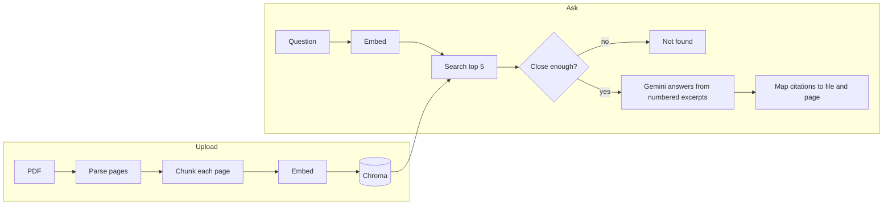

# DocuAsk

**Ask questions about your PDFs and get answers with the exact page they came from.**

DocuAsk is a retrieval-augmented generation (RAG) app. You upload PDFs, ask questions in plain English, and every claim in the answer links to the passage it was built from. If the answer is not in your documents, DocuAsk says so instead of guessing.

<!-- TODO: add a screenshot or GIF here, e.g.  -->
<!-- TODO: add your live demo link and demo video link here -->

## Why it exists

Ordinary chatbots can invent answers, and you cannot tell which ones are made up. DocuAsk is built around trust:

- **Answers only from your documents.** The model sees only the passages retrieved from your PDFs.
- **Verifiable citations.** Each `[1]`, `[2]` in an answer is a button that opens the exact passage, with the supporting sentence highlighted.
- **Honest "not found".** If nothing in your PDFs is close enough, the app answers "I couldn't find this in the uploaded documents." and does not call the language model at all.

## Features

- Upload one or more PDFs (drag and drop, or browse)
- Page-aware chunking, so every citation points to a real PDF page
- Answers with clickable citation chips and a source panel
- Search all documents, or limit a question to one
- Delete a document and all of its passages
- Duplicate detection: uploading the same file twice does nothing
- Clear messages for scanned PDFs, password-protected files, oversized files, and busy services
- Stop button while an answer is being generated
- Responsive layout with a documents drawer and a source bottom sheet on phones

## How it works



**Ingestion**
1. The PDF is read page by page with PyMuPDF. Pages with no text are skipped and counted.
2. Each page is split on its own, never across pages, so a chunk always has exactly one page number. The split is recursive (paragraph, then sentence, then word) at about 500 tokens with about 75 tokens of overlap. Chunks under about 30 tokens (headers, page numbers) are dropped.
3. Chunks are embedded with Gemini (`gemini-embedding-001`) and stored in Chroma with `file_name`, `page_number` and `chunk_index`.
4. The document ID is a hash of the file's contents, so the same file is never ingested twice, whatever it is named.

**Answering**
1. The question is embedded and the top 5 most similar chunks are fetched (cosine similarity).
2. Chunks scoring below `MIN_SIMILARITY` are dropped. If none are left, the answer is "not found" and the language model is never called.
3. The remaining chunks are sent to Gemini as numbered excerpts, with a strict instruction to answer only from them, cite by number, and say so when the answer is missing. Temperature is 0.
4. The backend reads the `[n]` markers in the reply and maps each to its real file and page. The model never writes a page number itself, and any number it makes up is removed.
5. Only the excerpts that the answer actually cited are returned as sources.

## Tech stack

| Part | Choice |
|---|---|
| Backend | Python 3.11+, FastAPI |
| PDF parsing | PyMuPDF |
| Embeddings and answers | Google Gemini API (`google-genai`) |
| Vector database | Chroma (local, persistent) |
| Frontend | React + Vite, plain CSS |
| Tests | pytest |

## Quick start

**You need:** Python 3.11 or newer, Node.js 20 or newer, and a free Gemini API key from [aistudio.google.com/apikey](https://aistudio.google.com/apikey).

```bash
# 1. Get the code
git clone https://github.com/<your-username>/docuask.git
cd docuask

# 2. Python environment
python -m venv .venv
source .venv/bin/activate          # Windows: .venv\Scripts\activate
pip install -r requirements.txt

# 3. Your API key
cp .env.example .env               # Windows: copy .env.example .env
# open .env and set GEMINI_API_KEY=your-key
```

**Run it for development** (two terminals):

```bash
# Terminal 1, project root: the API
uvicorn app.main:app --reload

# Terminal 2: the web interface
cd ui/web
npm install
npm run dev
```

Open **http://localhost:5173**. The API's interactive docs are at http://localhost:8000/docs.

**Run it as a single app** (what you would deploy):

```bash
cd ui/web
npm install
npm run build
cd ../..
uvicorn app.main:app
```

Open **http://localhost:8000**. FastAPI now serves the built interface and the API together.

## Configuration

Set these in `.env`. Only `GEMINI_API_KEY` is required.

| Variable | Default | What it does |
|---|---|---|
| `GEMINI_API_KEY` | none | Your Gemini API key |
| `GENERATION_MODEL` | `gemini-3.8-flash` | Model that writes answers |
| `EMBEDDING_MODEL` | `gemini-embedding-001` | Model that embeds text |
| `EMBEDDING_DIMENSIONS` | `768` | Size of each embedding vector |
| `MAX_OUTPUT_TOKENS` | `8192` | Output limit per answer (includes the model's thinking) |
| `CHUNK_SIZE_TOKENS` | `500` | Target chunk size |
| `CHUNK_OVERLAP_TOKENS` | `75` | Overlap between neighbouring chunks |
| `MIN_CHUNK_TOKENS` | `30` | Chunks smaller than this are dropped |
| `MAX_FILE_MB` | `20` | Largest PDF accepted |
| `EMBED_BATCH_SIZE` | `100` | Chunks embedded per API call |
| `TOP_K` | `5` | Passages fetched per question |
| `MIN_SIMILARITY` | `0.30` | Passages scoring below this are ignored. **Tune it** (see below) |
| `VECTORSTORE_DIR` | `data/vectorstore` | Where Chroma stores its files |

> If you change `EMBEDDING_MODEL` or `EMBEDDING_DIMENSIONS`, delete `data/vectorstore/` and upload your PDFs again. Vectors of different sizes cannot be searched together.

### Tuning `MIN_SIMILARITY`

The right value depends on your embedding model and documents. With Gemini embeddings, unrelated questions still score around 0.5, so the 0.30 default is too low. Measure it instead of guessing:

1. Ingest a PDF and list some questions in `eval/retrieval_check.json` (with the expected page, and a few off-topic questions with `"page": null`).
2. Run `python -m eval.check_retrieval`.
3. Set the suggested `MIN_SIMILARITY` in `.env` and run it again.

## API

Interactive documentation is at `/docs`. Summary:

| Method | Route | Purpose |
|---|---|---|
| `POST` | `/documents` | Upload a PDF. Returns 201, or 200 with `"status": "duplicate"` |
| `GET` | `/documents` | List uploaded documents |
| `DELETE` | `/documents/{doc_id}` | Delete a document and its passages |
| `POST` | `/ask` | Body `{"question": "...", "doc_ids": ["..."]}` (`doc_ids` is optional) |
| `GET` | `/config` | Settings the interface needs, such as the upload limit |
| `GET` | `/health` | Health check |

`/ask` returns:

```json
{
  "answer": "Employees get 20 days of paid leave per year [1].",
  "found": true,
  "cited": true,
  "sources": [
    {
      "number": 1,
      "file_name": "employee_handbook.pdf",
      "page_number": 14,
      "chunk_index": 2,
      "text": "Full-time employees are entitled to 20 days of paid leave...",
      "score": 0.7312
    }
  ]
}
```

Errors always use one shape: `{"error": {"type": "...", "message": "..."}}`.

| Status | Meaning |
|---|---|
| 400 | Not a PDF, or an empty question |
| 404 | Document not found |
| 413 | File too large |
| 422 | Scanned or password-protected PDF |
| 429 | Daily free quota for the Gemini model is used up |
| 503 | Gemini or the embedding service failed after retries |

Temporary failures (rate limits, busy servers) are retried automatically, waiting as long as the API asks. A daily quota error stops at once, because retrying cannot help.

## Evaluation

Two scripts check quality on your own questions. Both read `eval/retrieval_check.json`:

```bash
python -m eval.check_retrieval   # is the right page in the top 5? are off-topic questions rejected?
python -m eval.check_answers     # does the answer cite the right page? are off-topic questions refused?
```

`check_answers` makes one Gemini call per answerable question. On a free key it waits 13 seconds between questions to stay under the per-minute limit, and the daily limit is small, so run it sparingly.

**Results on a 10-question set from one research paper**

| Check | Result |
|---|---|
| Right page in the top 5 | 9 of 10 |
| Off-topic questions rejected at `MIN_SIMILARITY=0.59` | 5 of 5 |
| Answers citing the right page | _add your result from `check_answers`_ |

These numbers come from a small test set. Build your own for your own documents before trusting them.

## Tests

```bash
pytest
```

The tests use fake embedding, search and model objects, so they run offline and do not use any API quota. The Chroma and API tests are skipped automatically if those packages are missing.

## Project structure

```
docuask/
├── app/
│   ├── main.py            # FastAPI routes, serves the built UI
│   ├── schemas.py         # request and response shapes
│   ├── config.py          # settings from .env
│   ├── errors.py          # errors to HTTP status codes
│   ├── exceptions.py      # custom error classes
│   ├── ingestion/         # parser, chunker, tokens, pipeline
│   ├── retrieval/         # embedder, Chroma store, retriever
│   ├── generation/        # prompts, Gemini client, answerer
│   └── utils/             # logging, retry helper
├── ui/web/                # React + Vite interface
├── eval/                  # retrieval and answer checks
├── tests/
├── data/                  # sample PDFs and the local vector store
├── requirements.txt
└── .env.example
```

## Known limitations

- **Scanned PDFs are not supported.** There is no OCR, so image-only pages produce no text and the upload is rejected with a clear message.
- **Tables and multi-column layouts** may be extracted in a messy order. Check a few citations on your own documents.
- **Page numbers are the PDF's physical pages** (page 1 is the first page), not the numbers printed on the pages.
- **Free API limits are small.** The free Gemini tier allows only a handful of answers per minute and a small number per day for each model. Set `GENERATION_MODEL` to another model, or enable billing, for heavier use.
- **Single user, no login.** All uploaded documents are shared by everyone who can reach the server. Do not deploy it publicly with private documents.
- **Answers appear all at once.** There is no word-by-word streaming yet.
- **Answers are only as good as retrieval.** If the right passage is not in the top results, the model cannot use it. Always check the cited source.

## Roadmap

- Open the original PDF at the cited page
- Streaming answers
- OCR for scanned PDFs
- User accounts and per-user document collections
- Hybrid search (keyword plus vectors) and reranking
- Word and web page sources

## Troubleshooting

| Problem | Fix |
|---|---|
| `GEMINI_API_KEY is not set` | Create `.env` (not just `.env.example`) and restart uvicorn |
| 429 on `/ask` | The daily quota for that model is used up. Wait, or set another `GENERATION_MODEL` |
| `404 ... model is no longer available` | Google retired the model name. Set a current one in `GENERATION_MODEL` |
| Everything answers "not found" | `MIN_SIMILARITY` is too high, or no documents are uploaded. Run `python -m eval.check_retrieval` |
| Off-topic questions get answered | `MIN_SIMILARITY` is too low. Run `python -m eval.check_retrieval` |
| The page loads but nothing works | Make sure uvicorn is running on port 8000 |
| `http://localhost:8000` shows "Not Found" | Run `npm run build` in `ui/web`, then restart uvicorn |

## License

MIT. Add a `LICENSE` file before publishing, or choose another license.
